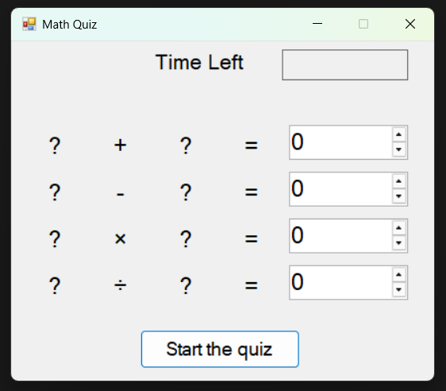
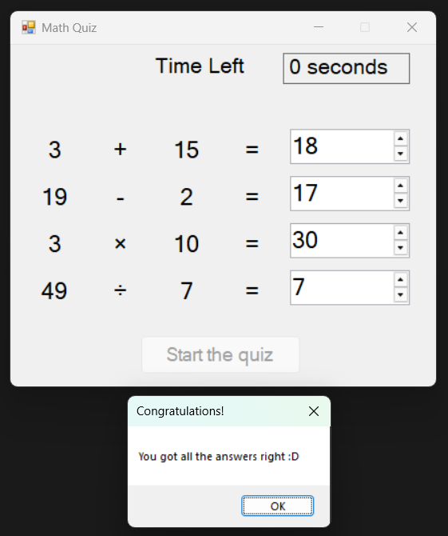
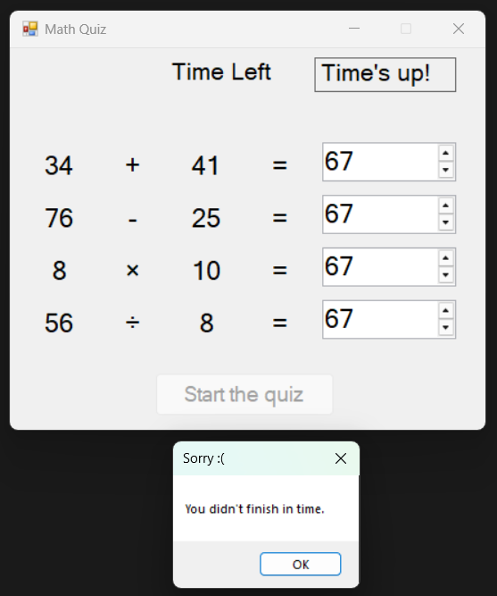
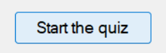

# Руководство пользователя
**MathQuiz** - представляет собой мини математический тест из четырёх задач: сложения, вычитания, умножения и деления на время.
[Сделанно по инструкции в рамках колледжа](https://learn.microsoft.com/ru-ru/visualstudio/get-started/csharp/tutorial-windows-forms-math-quiz-create-project-add-controls?view=visualstudio)
---
В начале вас встретит начальный экран, чтобы начать тест нажмите на `Start the quiz`

После чего можно решить тест за 30 сек, если решили раньше дождитесь таймера

Если не успели решить или решили неправильно увидете это сообщение

Чтобы пройти ещё раз нажмите на кнопку `Start the quiz`

